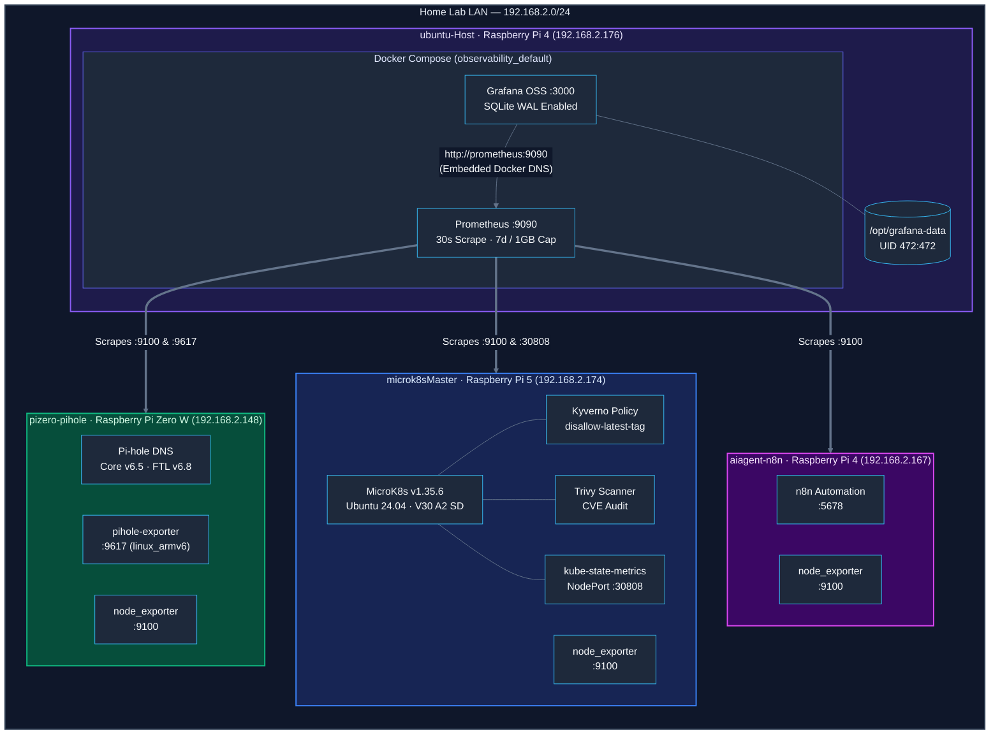

<div align="center">

# Multi-Node Raspberry Pi Home Lab
### MicroK8s Control Plane · DevSecOps Guardrails · n8n Automation · Centralized Observability

[](https://microk8s.io/)
[](https://prometheus.io/)
[](https://grafana.com/)
[](https://kyverno.io/)
[](https://n8n.io/)

**[Launch Interactive Animated Architecture Walkthrough (ASD-STE100)](https://luzon.arcilla.org/projects/homelab-walkthrough.html)** · **[Explore Deep-Dive Runbooks (`docs/`)](#documentation-index)**

</div>

---

> [!NOTE]
> **Design Philosophy:** Single-board clusters fail at the **microSD random-I/O layer** long before exhausting CPU. This architecture physically isolates Kubernetes control-plane state, time-series metrics storage, workflow automation, and edge DNS filtering across four dedicated Raspberry Pi boards, paired with least-privilege Linux service operators (`k8sops`, `gops`, `n8nops`).

---

## System Architecture Topology



---

## Hardware & Service Matrix

| Node Hostname | Hardware & Media | LAN IP | Operator | Active Workloads | Endpoints |
| :--- | :--- | :--- | :--- | :--- | :--- |
| **`microk8sMaster`** | Raspberry Pi 5<br>Ubuntu 24.04 · V30 A2 SD | `192.168.2.174` | `k8sops` | MicroK8s v1.35.6 (`dns`, `hostpath-storage`, `metrics-server`, `rbac`), Kyverno, Trivy, `kube-state-metrics`, `node_exporter` | `:9100/metrics`<br>`:30808/metrics` |
| **`ubuntu-Host`** | Raspberry Pi 4<br>Ubuntu LTS | `192.168.2.176` | `gops` | Docker Compose Observability Hub: `grafana-sandbox` (`grafana/grafana-oss`) & `prometheus` (`prom/prometheus`) | `:3000` (Grafana)<br>`:9090` (Prometheus) |
| **`aiagent-n8n`** | Raspberry Pi 4<br>Ubuntu LTS | `192.168.2.167` | `n8nops` | `n8n` workflow automation container & `prometheus-node-exporter` | `:5678` (n8n UI)<br>`:9100/metrics` |
| **`pizero-pihole`** | Raspberry Pi Zero W<br>Raspberry Pi OS (`armv6l`) | `192.168.2.148` | — | Pi-hole DNS sinkhole, `pihole-exporter` (`linux_armv6`), `node_exporter` v1.8.2 | `:9617/metrics`<br>`:9100/metrics` |

---

## Documentation Index

| Module | Guide | Coverage |
| :--- | :--- | :--- |
| **01** | **[Implementation Runbook](docs/01-implementation-runbook.md)** | MicroK8s control plane setup, namespace isolation (`cka-lab`, `devsecops`, `monitoring`), Kyverno & Trivy deployment |
| **02** | **[Edge DNS & Host Metrics](docs/02-edge-dns-and-host-metrics.md)** | Pi Zero W `systemd` units, `linux_armv6` binary selection, and Pi-hole v6 telemetry |
| **03** | **[Centralized Observability Stack](docs/03-centralized-observability-stack.md)** | Docker Compose stack, SQLite WAL tuning, UID `472:472` volume permissions, and Open-Meteo Infinity API |
| **04** | **[Troubleshooting Log](docs/04-troubleshooting-log.md)** | Root-cause analysis for 10 production issues (`SQLITE_BUSY`, `kine` SD stalls, `armv6l` binaries, Git/2FA) |
| **05** | **[Key Architectural Takeaways](docs/05-architectural-takeaways.md)** | Design patterns for microSD endurance, container DNS discovery, and operator privilege separation |

---

## SD-Card Endurance & Reliability Engineering

> [!TIP]
> **Preventing `SQLITE_BUSY` & TSDB Disk Exhaustion on Raspberry Pi:**
> * **SQLite Write-Ahead Logging:** `GF_DATABASE_WAL=true` and `GF_DATABASE_BUSY_TIMEOUT=10000` eliminate lock contention between Grafana's background alert scheduler and dashboard writes.
> * **Bounded Prometheus Storage:** `30s` global scrape intervals paired with `--storage.tsdb.retention.time=7d` and `--storage.tsdb.retention.size=1GB` cap write amplification.
> * **Embedded Bridge DNS:** Grafana queries `http://prometheus:9090` over `observability_default` (`127.0.0.11`), avoiding hairpin NAT and DHCP IP drift.

<details>
<summary><b>Click to expand: Troubleshooting Highlights & Root-Cause Resolutions (10 Issues Resolved)</b></summary>
<br>

| Symptom | Root Cause | Resolution |
| :--- | :--- | :--- |
| **MicroK8s `kine` freezes under load** | Slow random 4K write IOPS on an older SD card starved `kine` datastore commits | Rebuilt Pi 5 onto Ubuntu 24.04 LTS using a V30 A2 microSD card |
| **Grafana `database is locked (SQLITE_BUSY)`** | Concurrent background writes locked `grafana.db` under SQLite's rollback journal | Enabled `GF_DATABASE_WAL=true` and `GF_DATABASE_BUSY_TIMEOUT=10000` |
| **Grafana unreachable on `:30678`** | Legacy Kubernetes NodePort; Compose stack binds directly to host port `3000` | Verified listeners (`ss -tulpn`) & firewall, migrated to `:3000` |
| **`pihole-exporter` exec format error** | Ran ARM64/ARMv7 binary on Pi Zero W's `armv6l` CPU | Deployed `linux_armv6` release binary with `chmod +x` |
| **`sudo ufw status` denied for `gops`** | `gops` intentionally provisioned without root escalation | Separated `ubuntu` host admin from `gops` workload operator |

Full 10-item engineering log available in **[04. Troubleshooting Log](docs/04-troubleshooting-log.md)**.
</details>

---

## Repository Layout

```text
homelab-observability-devsecops/
├── README.md                                  # Architecture overview, topology & quick-start index
├── docs/
│   ├── 01-implementation-runbook.md           # Multi-node provisioning & DevSecOps setup
│   ├── 02-edge-dns-and-host-metrics.md        # Pi Zero W systemd & linux_armv6 exporters
│   ├── 03-centralized-observability-stack.md  # Compose, SQLite WAL, UID 472 & Infinity API
│   ├── 04-troubleshooting-log.md              # Full 10-issue root-cause resolution matrix
│   └── 05-architectural-takeaways.md          # Single-board reliability & security principles
└── observability/
    ├── docker-compose.yml                     # Grafana (SQLite WAL) + Prometheus (1GB TSDB cap)
    └── prometheus.yml                         # Cross-node scrape targets (30s interval)
```

---

## Next Milestones

- [ ] **Alertmanager → `n8n` Webhooks:** Route SD card I/O saturation (`>80%`), RAM pressure (`>85%`), and target down (`up == 0`) alerts to `aiagent-n8n` (`:5678`).
- [ ] **DevSecOps Event Pipeline:** Stream Trivy `CRITICAL` CVE findings and Kyverno policy blocks to `n8n` and post timeline annotations back to Grafana.
- [ ] **Observability Hub Self-Scraping:** Add `192.168.2.176:9100` to `prometheus.yml` to track `ubuntu-Host` disk and memory headroom.
